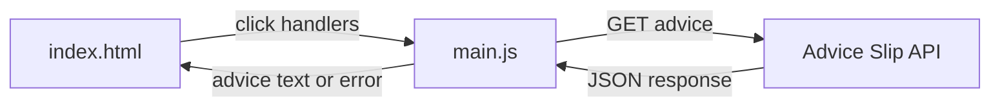

# Advice Box

Advice Box is a small vanilla JavaScript browser project for practicing asynchronous JavaScript. It fetches random advice from the public [Advice Slip API](https://api.adviceslip.com/advice) and renders the responses in the page.

The project compares one request, three concurrent requests, and three sequential requests. It also demonstrates `async`/`await`, `try`/`catch`, loading states, disabled controls, and console timing.

## Features

- Fetch and display one piece of advice with `async`/`await`.
- Show a loading message and disable the single-request button while its request is pending.
- Display caught request or response-parsing errors in the page.
- Fetch three independent responses concurrently with `Promise.all()`.
- Fetch three responses sequentially with `await` inside a loop.
- Log `parallel` and `sequential` timings with `console.time()` and `console.timeEnd()`.

## Architecture

`index.html` defines the buttons and output elements. `main.js` attaches click handlers, calls the API with the browser Fetch API, and renders the returned advice.



## Project Structure

```text
mini-project/
├── index.html                  # Buttons and output elements
├── main.js                     # Async request handlers and rendering
├── LEARNED.md                  # Concepts encountered and verified
├── plan.md                     # Staged learning plan and progress checklist
├── README.md                   # Project documentation
└── stage-13-async-plan.md      # Original project brief
```

## Technology Stack

- HTML
- Vanilla JavaScript
- Browser Fetch API
- Advice Slip API
- No framework, build tool, or third-party request library

## Prerequisites

- A modern web browser with JavaScript enabled
- Network access to `https://api.adviceslip.com/advice`

## Running

No package installation or build step is required. Open [index.html](index.html) in a browser, or serve the `mini-project` directory with any static file server.

The page provides three actions:

1. **Get Advice** fetches one response and displays its advice text.
2. **Get 3 Advice** fetches three responses concurrently and renders all three.
3. **Get 3 Advice(Seq)** fetches three responses one after another and renders all three.

Use the browser console to compare the `parallel` and `sequential` timing measurements. Network conditions and connection warm-up can affect the observed results.

## API

The application sends this request:

```text
GET https://api.adviceslip.com/advice
```

It reads `slip.advice` from a response shaped like this:

```json
{
  "slip": {
    "id": 123,
    "advice": "Some advice text"
  }
}
```

## Learning Materials

- [plan.md](plan.md) contains the staged objectives and progress checklist.
- [LEARNED.md](LEARNED.md) records concepts encountered during implementation, including Promises, `response.ok`, `finally`, `Promise.all()`, and sequential versus parallel requests.
- [stage-13-async-plan.md](stage-13-async-plan.md) contains the original standalone project brief.

## Testing

There is no automated test suite. Verify the application manually by exercising each button, observing the loading and disabled state for **Get Advice**, and checking the browser console and Network panel for request behavior.

## Future Improvements

> TODO: What should come next for this project after the async JavaScript learning stages are complete?

## License

> TODO: Confirm the license for this project.
